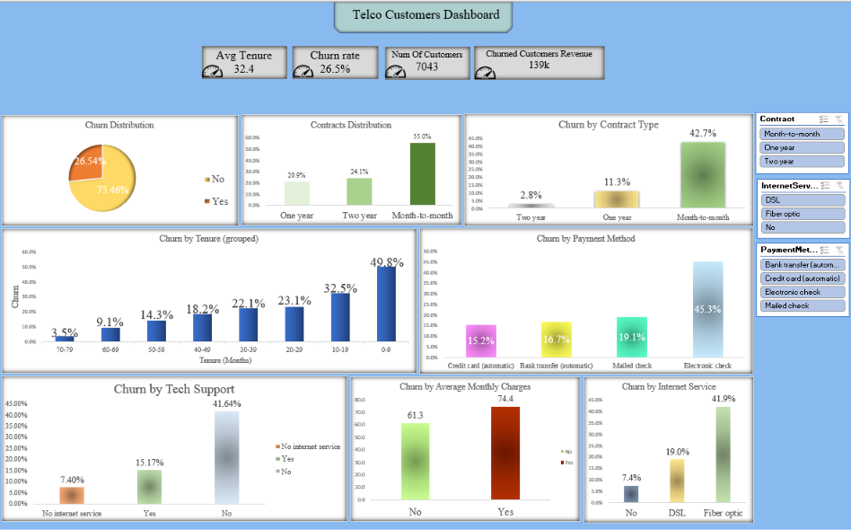

# Telco Customer Churn: Dashboard and Retention Call List

**Business question:** Which customers are leaving, why, and who should an account manager contact first?

## Overview
This project analyzes churn for a telecom company (7,043 customers, 26.5% churned). It combines an Excel dashboard that shows where churn happens with a Python model that scores each current customer's churn risk and turns the scores into a tiered call list with suggested actions.

**Data:** [IBM Telco Customer Churn dataset on Kaggle](https://www.kaggle.com/datasets/blastchar/telco-customer-churn). Download the CSV and place it next to the notebook.

## What's in this repo
| File | Description |
|---|---|
| `Telco_Churn_Dashboard.xlsx` | Excel workbook with the dashboard (pivot tables, slicers, KPI cards), recommendations, analysis, and call list sheets |
| `Telco_Churn_Analysis.ipynb` | Python notebook: cleaning, model, risk scores, tiers, and suggested actions |
| `churn_call_list.xlsx` | Call list for the 5,174 current customers |
| `Dashboard.pdf` | PDF export of the dashboard |

## Key findings
- Month-to-month customers churn at **42.7%**, versus 11.3% on one-year and 2.8% on two-year contracts.
- Churn is highest in the first 10 months of tenure (**49.8%**) and falls steadily to 3.5% for customers with 70+ months.
- Electronic check customers churn at **45.3%**, versus 15-19% for other payment methods.
- Fiber optic customers churn at **41.9%**, versus 19.0% for DSL.
- Customers without tech support churn at **41.6%**, versus 15.2% with it.
- Customers who churned paid about $13 more per month on average ($74 vs $61).
- Customers who churned represented about $139K in monthly charges, roughly 30% of the total.

## Recommendations
1. **Move month-to-month customers to longer contracts** with a first-year discount or a free add-on.
2. **Add early-tenure check-ins** at about months 1, 3, and 6, since nearly half of customers in their first 10 months leave.
3. **Encourage automatic payment** for electronic check customers with a small bill credit.
4. **Pilot a free tech support trial** for at-risk fiber customers, and track churn against a comparison group.

## Model
Logistic regression with balanced class weights (80/20 train/test split).

| Metric (churned class) | Value |
|---|---|
| Recall | 0.78 |
| Precision | 0.51 |
| Accuracy (overall) | 0.74 |

Recall was prioritized because missing a customer who is about to leave costs more than an extra call. The strongest drivers pointing toward churn were fiber optic, streaming services, and electronic check. Tenure and longer contracts pointed toward staying.

## Call list
Every current customer gets a churn risk score, a tier, and suggested actions that map to the dashboard findings.

| Tier | Customers | Monthly revenue | Outreach |
|---|---|---|---|
| 1 - Call this week | 136 | $11,657 | Personal call from an account manager |
| 2 - Check in this month | 1,261 | $93,624 | Automated email or SMS with an offer |
| 3 - Monitor | 3,777 | $211,704 | No action |

Tier 1 is customers with a risk score of 0.85 or more and a monthly bill at or above the median.

## Limitations
- The data shows association, not cause, so the recommendations should be run as pilots with a comparison group.
- Risk scores are a ranking, not literal probabilities, because of the balanced class weights.
- Scores were generated on data that includes the training set, so they are slightly optimistic.
- `MonthlyCharges` and `TotalCharges` overlap, so their individual model coefficients are not interpreted.
- The dataset is a public sample, not live CRM data.

## Tools
Excel (PivotTables, slicers, charts), Python (pandas, scikit-learn), Google Colab
